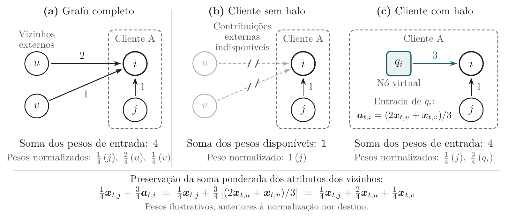

# FedGNN-Halo

Código da dissertação de mestrado **Aprendizado Federado em Grafos Espaço-Temporais Particionados: Um Estudo de Caso em Mobilidade Urbana**, desenvolvida no [Laboratório de Inteligência Artificial (LabIA)](https://labia.ufba.br/) do Programa de Pós-Graduação em Ciência da Computação da Universidade Federal da Bahia (PGCOMP/UFBA). Veja também o [GitHub do laboratório](https://github.com/LabIA-UFBA).

- **Autor:** Helder José Bastos Ramos
- **Orientador:** Prof. Dr. Ricardo Araújo Rios
- **Coorientador:** Prof. Dr. Bruno Veloso
- **Situação:** dissertação de 2026. Ainda não há artigo publicado com estes resultados; para citar, use a seção [Como citar](#-como-citar).

## 🗺️ Visão geral

No aprendizado federado em grafos, cada cliente treina com o subgrafo dos seus nós. As arestas que ligam clientes diferentes são cortadas, e os nós da fronteira deixam de receber as mensagens dos vizinhos externos. A dissertação examina como esse particionamento se relaciona com o erro da previsão e propõe o **FedGNN-Halo**, que representa as mensagens externas por nós virtuais.

O repositório reúne o método, os comparadores (centralizado, Local, FedAvg, FedProx e Ditto), os agrupamentos, os carregadores do SUNT, METR-LA e PEMS-BAY, exemplos executáveis e as receitas para reproduzir as análises da dissertação.

## 💡 Método

<p align="center"></p>

Para cada nó local $i$ que recebe arestas de outros clientes, o FedGNN-Halo acrescenta ao subgrafo um nó virtual $q_i$ com o agregado ponderado dos vizinhos externos,

$$a_{t,i} = \frac{\sum_{u \notin \text{cliente}} w_{ui}\, x_{t,u}}{W_i}, \qquad W_i = \sum_{u \notin \text{cliente}} w_{ui},$$

ligado a $i$ por uma aresta de peso $W_i$. Valores e máscaras de observação são agregados separadamente, com os mesmos pesos. Com uma camada LEConv, que normaliza os pesos pelo nó de destino, a soma dos pesos de entrada de $i$ volta a ser a do grafo completo e a saída do cliente reproduz a do modelo centralizado com os mesmos parâmetros.

O [notebook 00](notebooks/00_halo_step_by_step.ipynb) mostra essa construção passo a passo em um grafo pequeno, sem treinamento. Os limites estão descritos lá e na dissertação: a equivalência vale para uma camada LEConv com parâmetros fixos; o treinamento federado continua mudando os parâmetros compartilhados; e, na simulação, os agregados são preparados com acesso a todas as séries, sem oferecer, por si, proteção dos dados. Quando um nó tem um único vizinho externo, o agregado reproduz a série padronizada desse vizinho.

A implementação está em [`federation/halo.py`](federation/halo.py) (agregados) e [`experiments/fedgnnhet.py`](experiments/fedgnnhet.py) (treinamento). O nome interno `fedgnnhet` corresponde ao FedGNN-Halo e foi mantido nos runners por compatibilidade.

## 🗂️ Estrutura do repositório

```text
fedgnn_halo/   entrada de execução, exemplo sintético e agrupamentos intercambiáveis
models/        arquiteturas e fábrica build_model(ModelSpec, ...)
federation/    agregação de parâmetros, rodadas, objetivo local e agregados do halo
data_loader/   preparação e carregamento dos conjuntos
experiments/   treinamento, validação, checkpoints, métricas e análises da dissertação
examples/      configurações pequenas para começar
config/        configurações de referência importadas do código experimental
reproduction/  receitas resolvidas, partições, evidências e manifestos da dissertação
notebooks/     demonstração do método e exemplos de uso da API
tests/         contratos dos módulos, regressões e integração
docs/          página do projeto e guias
```

`models` não depende dos carregadores. `federation` recebe funções de construção do modelo, otimizador e treino local. Para acrescentar uma arquitetura, implemente-a em `models`, registre-a em `build_model` e adapte `experiments/task.py` se a assinatura de previsão mudar. Para um novo agrupamento, estenda `fedgnn_halo/partition.py` ou forneça os rótulos com `method: file`. Para um novo objetivo local, use `ObjectiveResult` e `train_local_epoch`, mantendo a agregação separada.

## 💾 Dados

| Conjunto | Alvo | Fonte |
| --- | --- | --- |
| SUNT | embarques por parada, por hora | [SUNT](https://github.com/LabIA-UFBA/SUNT) ([Ferreira et al., 2025](https://doi.org/10.1038/s41597-025-05674-6)), arquivos OD obtidos de [`labiaufba/PublicTransportationSunt`](https://huggingface.co/datasets/labiaufba/PublicTransportationSunt) |
| METR-LA | velocidade em rodovias (mph), a cada 5 min | Li et al. (2018), DCRNN |
| PEMS-BAY | velocidade em rodovias (mph), a cada 5 min | Li et al. (2018), DCRNN |

Os carregadores baixam os dados das fontes originais e conferem os hashes. Os dados não são redistribuídos neste repositório. Detalhes em [dados e experimentos](docs/experiments.md).

## ▶️ Começar do zero

Use Python **3.10 a 3.13**; recomendamos 3.11 ou 3.12. No terminal, na pasta em que deseja guardar o projeto:

```bash
git clone https://github.com/hjbramos/fedgnn-halo.git
cd fedgnn-halo
python3 -m venv .venv
source .venv/bin/activate
python -m pip install --upgrade pip
python -m pip install -e ".[dev,notebooks,reproduction]"
fedgnn-halo --config examples/synthetic.yaml
```

O clone público não exige autenticação. No Windows, use `.venv\Scripts\activate` no lugar de `source`. O primeiro exemplo usa CPU, 12 nós, três clientes e três rodadas. Não requer GPU nem download de bases. Se o diretório de saída já existir e contiver arquivos, escolha outro com `--output`.

```bash
fedgnn-halo --config examples/synthetic.yaml --method fedavg --output results/example-fedavg
fedgnn-halo --config examples/synthetic.yaml --method local --output results/example-local
fedgnn-halo --config examples/synthetic-gru.yaml
python -m pytest tests -q
jupyter lab notebooks/00_halo_step_by_step.ipynb
```

| Notebook | Conteúdo |
| --- | --- |
| [00 — FedGNN-Halo passo a passo](notebooks/00_halo_step_by_step.ipynb) | corte das arestas, agregados, nós virtuais e comparação com o grafo completo |
| [01 — Exemplo executável](notebooks/01_quickstart.ipynb) | uma execução do FedGNN-Halo em dados sintéticos |
| [02 — Métodos e agrupamentos](notebooks/02_methods_and_partitions.ipynb) | seis métodos e dois agrupamentos em execuções curtas |

Os notebooks têm saídas limpas e podem ser executados desde a primeira célula. Os exemplos sintéticos ilustram a API e não permitem tirar conclusões sobre os métodos.

### Exemplos curtos com dados reais

Com o ambiente ativado, execute estes comandos na raiz do repositório para comparar centralizado, FedAvg e FedGNN-Halo no METR-LA:

```bash
fedgnn-halo --config examples/metr-la.yaml --method centralized --output results/metr-centralized
fedgnn-halo --config examples/metr-la.yaml --method fedavg --output results/metr-fedavg
fedgnn-halo --config examples/metr-la.yaml --method halo --output results/metr-halo
```

O primeiro comando baixa automaticamente os dados das fontes públicas e os prepara em `data/`; os seguintes reutilizam esses arquivos. É necessário acesso à internet no primeiro uso. O CSV principal tem aproximadamente 73 MB, além dos arquivos do grafo e dos dados preparados.

Os três exemplos usam CPU, uma arquitetura reduzida e apenas **uma época no centralizado ou uma rodada nos métodos federados**. Eles verificam o funcionamento com dados reais; não reproduzem o orçamento nem os resultados da dissertação. O número de clientes é determinado pelo Leiden com resolução 1,0, sem usar as partições congeladas do protocolo principal.

Cada diretório de saída contém `summary.json` com as métricas, as configurações e os arquivos da execução. Para repetir um exemplo, escolha outro diretório com `--output`, pois saídas existentes não são sobrescritas.

### Alterar o experimento

O YAML define os pontos de configuração:

| Campo | Opções e finalidade |
| --- | --- |
| `method` | `centralized`, `local`, `fedavg`, `fedprox`, `ditto`, `halo` |
| `model` | LEConv, GRU, LSTM ou DCRNN e seus parâmetros |
| `partition` | `contiguous`, `random`, `leiden` com resolução, ou `file` com rótulos `.npy` |
| `training` | Épocas, rodadas, épocas locais, taxa de aprendizado, paciência e regularização |
| `dataset` | `synthetic` ou um dos três conjuntos reais, janela e horizonte |
| `seed`, `device`, `threads` | Semente, CPU/CUDA e limite de threads |

O halo implementado exige **uma camada LEConv**. Trocar a arquitetura não estende automaticamente sua propriedade de recuperação das mensagens. Leiden determina o número efetivo de grupos pela resolução; `clients` define o número nos agrupamentos contíguo e aleatório. Uma partição externa deve seguir exatamente a ordem dos nós do conjunto.

Cada execução grava configuração solicitada e resolvida, versões do ambiente, partição, histórico, modelo selecionado pela validação e métricas. A simulação é sequencial por padrão. As estimativas de comunicação não medem tráfego de rede. O método Local usa o ramo independente do treinador de modelos pessoais, com coeficiente zero e sem troca de parâmetros.

## 🔁 Reproduzir a dissertação

O [guia de reprodução](docs/reproduction.md) reúne as configurações resolvidas, as nove partições verificadas e os comandos por experimento e semente. É possível recalcular as análises registradas sem iniciar treinamentos:

```bash
python -m fedgnn_halo.reproduce verify
python -m fedgnn_halo.reproduce export-reference --output results/reference-recomputed
python -m fedgnn_halo.reproduce list
python -m fedgnn_halo.reproduce train --experiment metrla_halo_k20 --seed 42
```

O último comando só mostra o plano; treinar exige `--execute`. Os testes de instalação usam CPU, o que não implica que os treinamentos completos, especialmente no SUNT, tenham custo viável em CPU.

## 📊 Resultados da dissertação

MAE médio de teste em cinco sementes, com partições Leiden fixas. Diferença pareada FedGNN-Halo − FedAvg; valores negativos indicam menor erro do FedGNN-Halo. $p$ do teste $t$ pareado ajustado por Holm na família principal. Valores do pacote de referência em [`reproduction/reference`](reproduction/reference).

| Conjunto | Centralizado | $k$ | FedAvg | FedGNN-Halo | Diferença | $p$ (Holm) |
| --- | ---: | ---: | ---: | ---: | ---: | ---: |
| SUNT (embarques/h) | 3,9416 | 6 | 4,0079 | 3,9652 | −0,0427 | 1,000 |
| | | 20 | 4,0739 | 4,0679 | −0,0060 | 1,000 |
| | | 166 | 4,3353 | 4,3288 | −0,0065 | 1,000 |
| METR-LA (mph) | 3,7750 | 5 | 3,7954 | 3,7945 | −0,0009 | 1,000 |
| | | 10 | 3,8567 | 3,8470 | −0,0097 | 0,722 |
| | | 20 | 3,9144 | 3,8761 | −0,0383 | 0,022 |
| PEMS-BAY (mph) | 1,9613 | 5 | 1,9567 | 1,9573 | +0,0006 | 1,000 |
| | | 10 | 1,9630 | 1,9634 | +0,0004 | 1,000 |
| | | 20 | 1,9767 | 1,9765 | −0,0002 | 1,000 |

O MAE do FedAvg aumentou com o número de clientes nos três conjuntos. O FedGNN-Halo teve menor MAE nas cinco execuções do METR-LA com 20 clientes, com diferença estatisticamente significativa e de pequena magnitude; nas demais configurações, as comparações foram inconclusivas, sem demonstrar ausência de benefício ou equivalência. As famílias de comparação foram organizadas após o conhecimento dos resultados; com famílias mais amplas, o $p$ ajustado do METR-LA com 20 clientes passa a 0,074 ou 0,081. Os controles, as comparações com FedProx, Ditto e Local, a comunicação e as limitações estão na dissertação.

## 📝 Como citar

Enquanto não houver artigo publicado, cite a dissertação e este repositório. O arquivo [`CITATION.cff`](CITATION.cff) traz os metadados usados pelo GitHub em "Cite this repository".

```bibtex
@mastersthesis{ramos2026fedgnnhalo,
  author = {Ramos, Helder Jos{\'e} Bastos},
  title  = {Aprendizado Federado em Grafos Espa{\c{c}}o-Temporais Particionados: Um Estudo de Caso em Mobilidade Urbana},
  school = {Universidade Federal da Bahia, Programa de P{\'o}s-Gradua{\c{c}}{\~a}o em Ci{\^e}ncia da Computa{\c{c}}{\~a}o},
  address = {Salvador},
  year   = {2026},
  note   = {C{\'o}digo: https://github.com/hjbramos/fedgnn-halo}
}
```

Ao usar os conjuntos de dados, cite também suas fontes: o SUNT (Ferreira et al., 2025) e o DCRNN (Li et al., 2018) para METR-LA e PEMS-BAY.

## ⚖️ Procedência e licença

`SOURCE.json` registra a revisão e os hashes do código experimental usado como base. Os módulos de distribuição e a injeção de dados/partições nos treinadores foram acrescentados sem mudar as fórmulas de agregação. As referências às arquiteturas e aos métodos foram preservadas. Veja [atribuições](docs/attributions.md).

O código próprio está disponível sob a [licença MIT](LICENSE). As licenças dos conjuntos e das dependências continuam independentes. Não há autorização de redistribuição dos dados implícita neste repositório.
